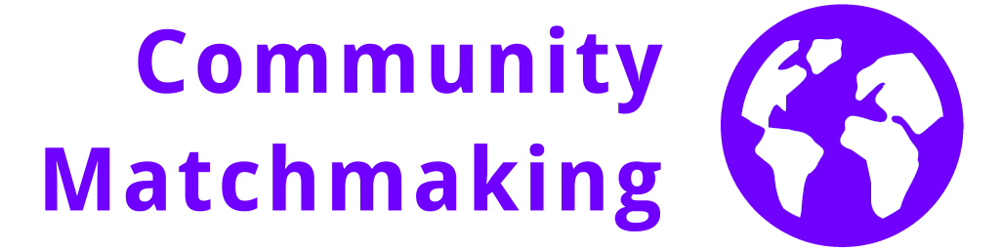

# 

Community Matchmaking (CMM) is an alternative matchmaking system for Trackmania 2020 designed to bring matchmaking on custom, community-made game modes or maps.

As of today, only the FlagRush game mode is playable with CMM, other game modes and maps will come out afterwards.

This Github repository is where the plugin (the client) lives on. You can use the [issue tracker](https://github.com/GreepTheSheep/openplanet-cmm/issues) to check issues and planned features with the plugin, the matchmaker, the server and the Controller.

## Early access

As of today, CMM is in early closed access. For the players who joined the early access, you should be able to have some private CMM channels in my [Discord server](https://greep.fr/#/discord) where you can discuss, looking for players and of course report quick issues about CMM.

For this early access, I'm focusing on tracking issues to being operational for the final public release, so everyone is welcome!

## Playing CMM

Download the [CMM Plugin on Openplanet](https://openplanet.dev/plugin/cmm) (you can also download via the Plugin Manager), then open the window via the "Scripts" menu.

---

The project is licensed under the [GPL-3.0 License](/LICENSE).